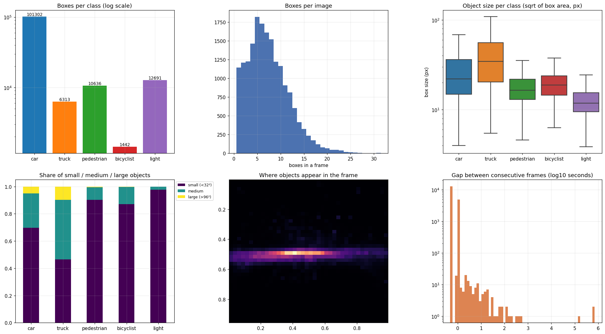
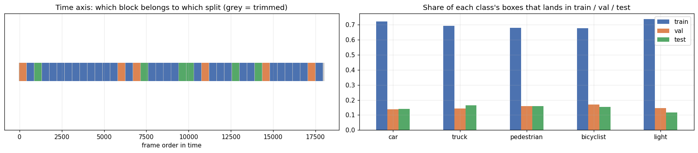
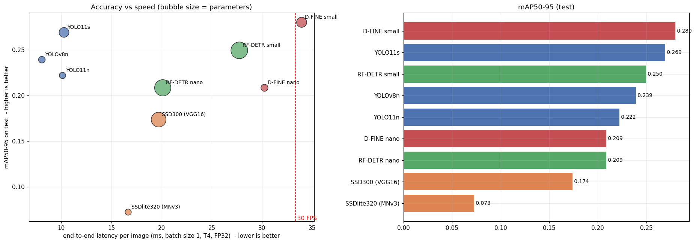
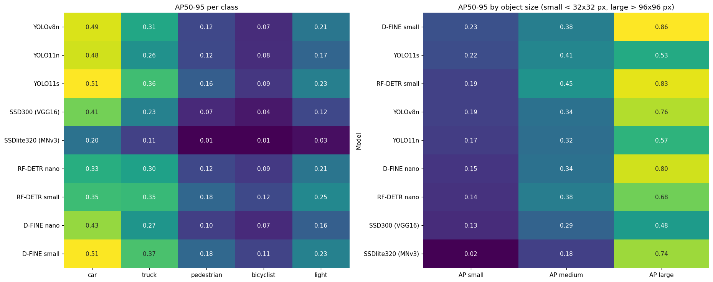
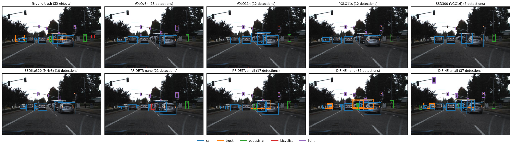
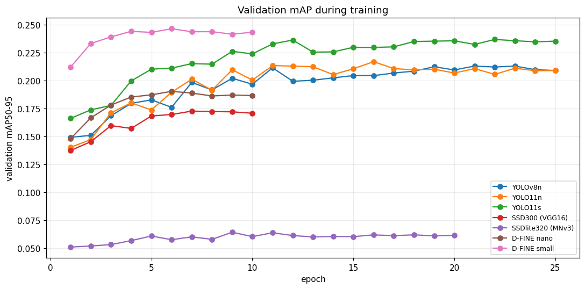

# 🚗 Real-Time Object Detection for Self-Driving Cars

> **From a YOLO-vs-SSD experiment to a leakage-free benchmark of 9 real-time detectors on front-camera road scenes**


---

## 🔰 Overview
This repository compares **nine real-time object detectors** on the same task and the same data: finding **cars, trucks, pedestrians, bicyclists and traffic lights** in images from a car-mounted front camera.

The project asks a question that matters for driving, where a model has to be both accurate **and** fast:

> *Which real-time detector gives the best trade-off between accuracy and speed, when every model is trained and evaluated under the same leakage-free protocol?*

Compared models (all fine-tuned from COCO-pretrained weights):

- 📱 SSDlite320 (MobileNetV3-Large)  
- 🎯 SSD300 (VGG16)  
- ⚡ YOLOv8n  
- ⚡ YOLO11n  
- ⚡ YOLO11s  
- 🔲 RF-DETR nano  
- 🔲 RF-DETR small  
- 🔬 D-FINE nano  
- 🔬 D-FINE small  

The project has two parts:
1. **Notebook (version 2) · The benchmark** → data audit and EDA, a time-based leakage-free split, nine models trained under one protocol, one shared evaluator, a speed benchmark, and a visual comparison of every model's predictions.  
2. **Archive (version 1) · The original experiment** → my first YOLOv8n vs SSD300 notebook. It is kept as a record of where the project started and of what changed (see [Project History](#-project-history)).

---

## 📦 Dataset
The notebook uses a road-scene dataset that I published on Kaggle:  
👉 [Car Camera Photos](https://www.kaggle.com/datasets/mbsoroush/car-camera-photos)

- **22,241** images on disk, of which **18,000** have annotations (the other 4,241 are not labelled and are ignored)  
- **132,406** annotation rows (132,384 boxes after cleaning), **7.4 objects per image** on average (maximum 31)  
- All images are **480 × 300** px JPEG frames from a moving car; file names are timestamps, so the frames are **consecutive video frames**  
- Classes: `car`, `truck`, `pedestrian`, `bicyclist`, `light` (mapping confirmed visually in the notebook)  

| Class | Boxes |
|---|---|
| car | 101,302 |
| light | 12,691 |
| pedestrian | 10,636 |
| truck | 6,313 |
| bicyclist | 1,442 |

The task is hard for two reasons: **73 %** of the objects are smaller than 32 × 32 px (median box 22 × 20 px), and the classes are very imbalanced (cars outnumber bicyclists about **70 : 1**).



The dataset remains subject to the terms of its original source; see the Kaggle dataset page.

---

## ⚙️ Installation
Clone the repository and install the dependencies:

```bash

git clone https://github.com/mbsoroush/RealTimeObjectDetectionForSelfDrivingCars.git
cd RealTimeObjectDetectionForSelfDrivingCars

pip install -r requirements.txt

```

Two packages need care (both caused real failures during development, see [Troubleshooting](#-troubleshooting)):
`setuptools` must be older than 81 (it provides `pkg_resources`, which RF-DETR's training library imports), and `torchaudio` must not be installed with a mismatched version (it breaks `import transformers`). `requirements.txt` already handles both.

## 🚀 Usage

**On Kaggle (the tested setup):**

1. ✅ Open the Kaggle notebook and add the dataset `mbsoroush/car-camera-photos` as input  
2. ✅ Enable **GPU T4 x2** and **Internet** (the pretrained weights are downloaded)  
3. ✅ Run all cells  

The notebook has a `FAST_DEV` switch in its configuration cell:

| Setting | What it does | Time |
|---|---|---|
| `FAST_DEV = True` | Runs the **whole pipeline** on a tiny subset (360 / 120 / 120 train / validation / test frames, one epoch per model). It only checks that every model trains, predicts, benchmarks and plots; its numbers are not meaningful. | about 30–50 min |
| `FAST_DEV = False` | The full experiment on all nine models (the results below). | about **6.1 h** on 2x T4 |

The two GPUs work through two job queues in parallel; every model has a time cap, and the notebook stops starting new work before Kaggle's 12-hour limit. With one GPU, the models run sequentially.

**Locally:** not tested. The notebook reads the data from `INPUT_ROOT` (default `/kaggle/input`, any folder that contains `labels_train.csv` works) and writes to `WORK_DIR` (default `/kaggle/working`). Its helper scripts are written to `/kaggle/working/outputs/scripts/`, so that directory has to exist and be writable.

---

## 🧹 Preprocessing Steps

All models share one data protocol, so their results are comparable:

1. ✅ **Data audit and cleaning**  
   - Exact duplicate rows removed (20), boxes thinner than 2 px removed (2), reversed or out-of-image boxes checked (none found)  
   - Class mapping verified by looking at random crops of every class  

2. ✅ **Leakage-free, time-based split**  
   - The frames are consecutive video frames, so a random split would put near-identical images in train and test  
   - Frames are sorted by timestamp and cut into **40 contiguous blocks**; whole blocks go to train / validation / test (70 / 15 / 15 %)  
   - Out of many random block assignments, the one with the **best class balance** across the three splits is chosen  
   - **10 frames are trimmed at both edges of every block**; the closest train and test frames are 21 frames apart  
   - Result: 12,040 train / 2,580 validation / 2,580 test frames (91,444 / 17,912 / 17,957 boxes)  
   - The validation split selects checkpoints; the **test split is used once**, at the end  

3. ✅ **Same files for every model**  
   - The split is exported once (YOLO format, also read by RF-DETR) and the annotation table is shared by the SSD and D-FINE scripts  



---

📌 After preprocessing, the data was ready for training on every model.

## 🧠 Model Training Steps

All models were trained on Kaggle with GPU acceleration (2x Tesla T4).

1. ✅ **Models** (COCO-pretrained, new 5-class head)  

| Family | Models | Library |
|---|---|---|
| SSD | SSD300 (VGG16), SSDlite320 (MobileNetV3) | torchvision |
| YOLO | YOLOv8n, YOLO11n, YOLO11s | Ultralytics |
| RF-DETR | nano, small | rfdetr |
| D-FINE | nano, small | Hugging Face Transformers |

2. ✅ **Training setup**  
   - Each family uses its own fine-tuning recipe (Ultralytics defaults for YOLO, the package defaults for RF-DETR, AdamW with a cosine schedule for SSD and D-FINE), with a **wall-clock cap** per model (none of them reached it)  
   - Epochs: YOLO 25, SSD300 10, SSDlite320 20, RF-DETR 10, D-FINE 10  
   - The best checkpoint on the **validation split** (by validation mAP, following each framework's selection rule) is the one evaluated on test  
   - Each model runs in its own process, so a failure never stops the others  

3. ✅ **One evaluator for all models**  
   - Predictions of every model are scored with **pycocotools** (mAP50-95, mAP50, AP by object size, per-class AP, AR) on the same test frames  
   - Precision, recall and F1 at a fixed operating point (score ≥ 0.25, IoU ≥ 0.5)  

4. ✅ **Speed benchmark**  
   - Measured separately, **one model at a time on an idle GPU**: batch size 1, FP32  
   - End-to-end: raw image in, final detections out (pre-processing and NMS included where a model needs it)  
   - Real-time is defined as **at least 30 FPS**  

5. ✅ **Visual comparison**  
   - Every model's predictions are drawn on the same test images, next to the ground truth  

---

📌 After training and evaluation, every model was compared on accuracy, speed and size, not on accuracy alone.

## 📊 Results

### Test split: 2,580 frames, 17,957 boxes (single run per model)

| Model | Params | Input | Epochs | Train time | mAP50-95 | mAP50 | Latency | FPS | ≥ 30 FPS |
|---|---|---|---|---|---|---|---|---|---|
| D-FINE small | 10.2 M | 480 | 10 | 96.6 min | **0.280** | 0.531 | 33.9 ms | 29.5 | no (borderline) |
| YOLO11s | 9.4 M | 480 | 25 | 48.1 min | 0.269 | 0.516 | 10.2 ms | 97.6 | yes |
| RF-DETR small | 31.8 M | 512 | 10 | 122.3 min | 0.250 | **0.554** | 27.7 ms | 36.1 | yes |
| YOLOv8n | 3.1 M | 480 | 25 | 37.4 min | 0.239 | 0.468 | **8.0 ms** | **124.3** | yes |
| YOLO11n | 2.6 M | 480 | 25 | 43.6 min | 0.222 | 0.434 | 10.1 ms | 98.9 | yes |
| D-FINE nano | 3.7 M | 480 | 10 | 75.3 min | 0.209 | 0.409 | 30.2 ms | 33.1 | yes |
| RF-DETR nano | 30.2 M | 384 | 10 | 97.0 min | 0.209 | 0.484 | 20.1 ms | 49.8 | yes |
| SSD300 (VGG16) | 24.3 M | 300 | 10 | 41.5 min | 0.174 | 0.368 | 19.7 ms | 50.8 | yes |
| SSDlite320 (MNv3) | 2.3 M | 320 | 20 | 43.0 min | 0.073 | 0.162 | 16.7 ms | 60.1 | yes |

**Key findings**

1. ✅ **Best trade-off: YOLO11s.** It reaches 0.269 mAP50-95, **96 % of the best accuracy, at about 3.3x the speed** of D-FINE small (10.2 ms vs 33.9 ms)  
2. ✅ **Most accurate: D-FINE small** (0.280), but at 29.5 FPS it just misses the 30 FPS line on a T4. It uses the unoptimised Hugging Face implementation, so a deployed version would likely be faster  
3. ✅ **Fastest: YOLOv8n** (8.0 ms, 124 FPS) still reaches 0.239, ahead of every nano model and both SSDs  
4. ✅ **RF-DETR small has the best mAP50** (0.554) but loses accuracy at strict overlap, so its boxes are placed less tightly than those of D-FINE small or YOLO11s  
5. ✅ **Eight of nine models run at 30 FPS or more**; the only one that does not is D-FINE small, by half a frame per second  
6. ✅ **SSD is clearly behind the newer families:** SSD300 reaches 0.174 and SSDlite320 only 0.073. The fixed 300 / 320 px input shrinks small objects further, and SSDlite's validation mAP stayed flat after the first epoch, so its result mainly reflects this input size and recipe  
7. ✅ **Rare classes and small objects are the bottleneck for every model:** pedestrian AP is 0.01–0.18 and bicyclist AP 0.01–0.12 (cars: 0.20–0.51), and small-object AP is only 0.02–0.23 against 0.48–0.86 for large objects  
8. ✅ **Precision at a fixed threshold is not comparable across families:** D-FINE shows precision of about 0.3 at score 0.25 but recall of about 0.8, because it emits several overlapping class guesses per object. Threshold-free mAP is the fairer comparison  

**Which model should I pick?**

| Situation | Choice |
|---|---|
| Real-time driving, best balance of accuracy and speed | YOLO11s |
| Smallest and fastest model | YOLOv8n |
| Highest accuracy, about 30 FPS is enough (or an optimised runtime is available) | D-FINE small |
| Good accuracy at loose overlap (mAP50) | RF-DETR small |









---

📌 On this dataset, speed, size and rare-class performance separate the models more than the top accuracy numbers do.

## 🕰️ Project History

The project started as a two-model experiment (version 1, kept in `archive/`) and was rebuilt as a controlled benchmark (version 2, the main notebook).

| | Version 1 (`archive/`) | Version 2 (main notebook) |
|---|---|---|
| Models | YOLOv8n, SSD300 | 9 models in 4 families |
| Split | Random split of **annotation rows** (80 / 20) | **Time-based** split by frame, with trimmed block edges and a separate test set |
| SSD training | 50 epochs from a VGG16 feature backbone, no pretrained detector | Fine-tuned from COCO-pretrained detectors |
| Evaluation | Per-framework metrics, validation only | One shared evaluator, held-out test set |
| Speed | not benchmarked | End-to-end latency, batch size 1 |
| Class names | `class_1` to `class_5` | Named and verified visually |

What version 1 showed, and why it was replaced:

1. ❌ **The split leaked.** Rows were split, not frames, so the same image appeared in both train and validation with different subsets of its boxes (17,707 train images and 12,950 validation images from about 18,000 frames). Its numbers cannot be compared with version 2.  
2. ❌ **Validation labels were incomplete.** Each copy of a frame only carried part of its true boxes, which lowered precision (0.23 for YOLOv8n, with recall 0.63; mAP50 0.197, mAP50-95 0.108).  
3. ❌ **The SSD result was a setup problem, not an architecture result.** Trained without a pretrained detector on 300 × 300 inputs, it ended at mAP50 0.033 (mAP50-95 0.013, recall@100 0.14) and stopped improving after the first epochs.  

Version 2 fixes these issues, and the comparison was widened so the conclusions rest on a fair protocol. The archived notebook is kept unchanged for transparency.

---

## 🧪 Troubleshooting

Common issues and their solutions when running the notebook:

1. ❌ **`No module named 'pkg_resources'` when RF-DETR starts**  
   - Cause: `setuptools` 82 or newer no longer ships `pkg_resources`, which `pytorch-lightning` still imports  
   - ✅ Solution:  
     - `pip install "setuptools<81"` (the notebook's install cell already does this)  

2. ❌ **D-FINE is skipped; `import transformers` fails with a `libtorchaudio` error**  
   - Cause: installing RF-DETR / Ultralytics upgrades torch, and the pre-installed `torchaudio` no longer matches  
   - ✅ Solution:  
     - `pip uninstall -y torchaudio` (it is not needed here; the install cell already does this)  

3. ❌ **A model family is reported as MISSING in the environment check**  
   - Cause: a package failed to install or import  
   - ✅ Solution:  
     - Read the message printed next to the package; the notebook tries to repair known problems automatically and skips only the affected models  

4. ❌ **`FileNotFoundError` when locating the dataset**  
   - ✅ Solution:  
     - On Kaggle, add `car-camera-photos` as input; locally, set `INPUT_ROOT` to a folder that contains `labels_train.csv` and the images  

5. ❌ **Weights fail to download**  
   - Cause: Internet is turned off  
   - ✅ Solution:  
     - Turn Internet on; the COCO-pretrained weights are downloaded at the start of each model  

6. ❌ **RF-DETR shows no progress for a long time**  
   - Cause: its training library logs little to the notebook  
   - ✅ Solution:  
     - Wait for the "still running" line printed every 10 minutes, or read `outputs/logs/rfdetr_*_train.log`  

7. ❌ **Results differ slightly from the README**  
   - Cause: GPU operations are not fully deterministic, even with fixed seeds, and every model was trained once  
   - ✅ Solution:  
     - Differences below about 0.01–0.015 mAP50-95 are expected  

---

📌 Following these steps should resolve most issues encountered when running the notebook.

## 📦 Deliverables

The project includes the following components:

1. ✅ Benchmark notebook (version 2) → `notebooks/real-time-object-detection-for-self-driving-cars.ipynb` ([Kaggle version](https://www.kaggle.com/code/mbsoroush/real-time-object-detection-for-self-driving-cars))  
2. ✅ Original experiment (version 1) → `archive/object-detection-for-self-driving-cars-v1.ipynb`  
3. ✅ Dependencies → `requirements.txt`  
4. ✅ Figures → `results/figures/`  
5. ✅ Dataset → Car Camera Photos on Kaggle (`car-camera-photos`)  

---

## 🏁 Conclusion

1. ✅ **Objective Achieved**  
   - Trained and compared 9 real-time detectors from 4 families under one leakage-free protocol, with a shared evaluator and a separate speed benchmark  

2. ✅ **Key Features**  
   - A time-based split that prevents near-identical neighbouring frames from leaking between train and test  
   - One evaluator (pycocotools) for every model, with per-class and per-size AP  
   - End-to-end latency measured at batch size 1 on an idle GPU  
   - Side-by-side visual predictions of every model on the same test images  
   - A pipeline that isolates every model in its own process, repairs known environment problems and respects a global time budget  

3. ✅ **Impact**  
   - Shows that accuracy alone does not choose a real-time detector: the most accurate model (D-FINE small) is about 3.3x slower than the model with 96 % of its accuracy (YOLO11s)  

4. ✅ **Limitations**  
   - Every model was trained **once**, so gaps below about 0.01–0.015 mAP50-95 should not be read as real differences  
   - Models keep their own native input sizes (RF-DETR 384 / 512, SSD 300 / 320, others 480) and different epoch counts  
   - Latency was measured on a Kaggle T4 in FP32; the D-FINE numbers use the unoptimised Hugging Face port and torchvision's SSD post-processing adds fixed overhead, so those latencies are pessimistic  
   - One dataset with a single camera setup; large-object AP rests on few boxes and is noisy  
   - The effect of the time-based split was not measured against a random split in version 2  

5. ✅ **Future Improvements**  
   - Higher input resolution, since most objects are tiny (a hypothesis still to be tested)  
   - Class-balanced sampling or loss weighting for pedestrians and bicyclists  
   - Several seeds per model to measure run-to-run noise  
   - ONNX / TensorRT exports for more realistic deployment latencies  
   - A one-model ablation on a random split to quantify the leakage effect  

---

📌 With this project, we showed that **a fair, leakage-free comparison** matters more than any single accuracy number when choosing a real-time detector.

## ⚖️ License

This project is licensed under the [GNU General Public License v3.0](https://github.com/mbsoroush/RealTimeObjectDetectionForSelfDrivingCars/blob/main/LICENSE).  
You are free to use, modify and distribute the code under the terms of the GPL-3.0; derivative works must be released under the same license.

The archived version-1 notebook keeps the licence notice from its original header. The dataset is not covered by this license: it remains subject to the terms of its original source on Kaggle.
